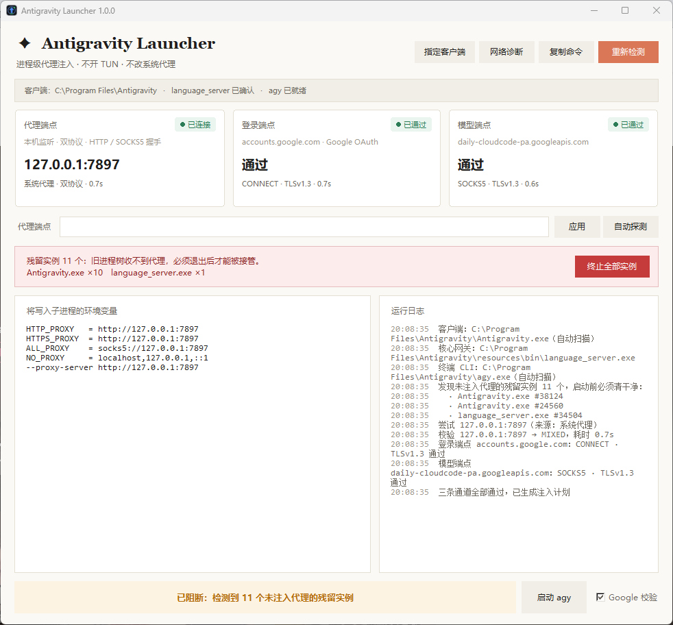

# Antigravity Launcher

[](https://github.com/Geekwaner/antigravity-launcher/actions/workflows/ci.yml)
[](https://github.com/Geekwaner/antigravity-launcher/releases)
[](LICENSE)
[](https://www.python.org/downloads/)

[简体中文](README.md) · [English](README_EN.md)

给 Google Antigravity 桌面客户端用的**进程级代理启动器**。不接管整机网络，只在启动 Antigravity
的那一刻，把代理信息写进它的进程环境。

- 不开 TUN、不改系统代理、不装虚拟网卡、不需要管理员权限
- 只影响被拉起的那一棵进程树，客户端退出即消失
- 纯 Python 3.10+ 标准库，无第三方依赖（界面用 tkinter）

界面预览：

| 三通道全绿，可启动 | 检测到残留实例，亮红阻断 |
|---|---|
|  |  |

---

## 一、为什么需要它

Antigravity 不是一个进程。真正发请求的是 `resources/bin/language_server.exe`（Go 写的），
OAuth、`loadCodeAssist`、`fetchAvailableModels`、模型流式输出全部走它。

三套网络栈找代理的方式互不相通：

| 层 | 怎么找代理 |
|---|---|
| Electron / Chromium | 读操作系统的「系统代理」设置 |
| Go `net/http` | **只读环境变量**，读不到注册表 |
| Node 核心 `https` | 两者都不读 |

所以「系统代理明明开着，反重力还是连不上」是必然结果：Go 那一层不看注册表，于是直连，
于是 DNS 污染和 TLS 重置。典型日志是 `getaddrinfo ENOTFOUND daily-cloudcode-pa.googleapis.com`
和 `Client network socket disconnected before secure TLS connection was established`。

而环境变量只能在**创建进程时**被继承，无法事后注入正在运行的进程。这就是为什么必须由本工具
来启动 Antigravity，也为什么必须先退干净旧实例。

---

## 二、它做了什么

1. **定位客户端与终端 CLI** — 扫描各平台常见安装目录（macOS 兼容 `mdfind` 并跳过自身包装目录，Linux 解析 `.desktop`），并用同目录下的 `resources/bin/language_server` 二次确认，避免认错同名程序；同时自动识别终端版 `agy` CLI（扫描常见目录及 `PATH`）。找不到可手动指定，结果会记住。
2. **验证代理（含认证支持）** — 先读系统代理（Windows 注册表 / macOS `scutil` / Linux `gsettings`），再读环境变量，最后并扫常见本地端口。每个候选都要通过**真实握手**：同时尝试 HTTP CONNECT 与 SOCKS5（均支持用户名/密码认证），对 `accounts.google.com`（登录）和 `daily-cloudcode-pa.googleapis.com`（模型）两个目标分别验证：隧道建立后还要穿过隧道完成一次 TLS 握手。端口开着不算数。
3. **启动前 Google 真实可达性校验（默认开启，可关闭）** — 本地代理握手成功只代表代理客户端在监听，不代表远端节点可用。启动前可选穿过同一隧道对 `https://www.google.com/generate_204` 发起一次**保留完整证书校验**的 HTTPS 请求，避免死节点或过期订阅导致假绿；可在界面右下角开关或命令行用 `--no-preflight` 跳过。
4. **实时状态追踪 & 区分己方与残留实例** — 记录由本启动器拉起的客户端 PID 与真实进程创建时间（防 Windows PID 复用）：重开启动器时也能识别自己拉起的实例并实时跟踪退出状态；若存在外部未注入代理的残留实例，则亮红阻断并给出终止按钮。
5. **启动与终端工具** — 注入 `HTTP_PROXY` / `HTTPS_PROXY` / `ALL_PROXY` 及小写变体，附带 `--proxy-server` 把 Chromium 层也钉在同一端点，拉起后轮询进程树确认 `language_server` 接管（父进程秒退时立刻早退告警，无需空等超时）。另外支持一键打开注入代理的终端 / 启动 `agy`、一键复制各 Shell 代理命令、以及「直连 IP vs 代理出口 IP + 延迟」网络诊断。

`NO_PROXY` 固定包含 loopback（`localhost,127.0.0.1,::1`）。这不是可选项：Antigravity 的界面
由本地 Go 服务在 `127.0.0.1` 提供，OAuth 回调也监听 localhost，代理接管回环地址会直接白屏。

---

## 三、使用方法

### 方式一：普通用户直接下载（Releases）

前往 [GitHub Releases](https://github.com/Geekwaner/antigravity-launcher/releases) 下载打包好的产物（无需安装 Python）：

- **`AntigravityLauncher-<版本>-win-x64-portable.zip`（推荐）**：目录绿色版，启动秒开、误报率更低。**请先完整解压到文件夹**，再双击运行 `AntigravityLauncher.exe`（同目录附带命令行工具 `aglaunch.exe`）。
- **`AntigravityLauncher-<版本>-win-x64-standalone.exe`**：单文件便携版，免解压直接双击运行（首次打开需自解压约 1–2 秒）。

> Releases 目前**仅提供 Windows x64 预编译产物**。macOS / Linux 用户请使用下面的「方式二：源码运行」。
>
> 若 Windows SmartScreen 弹出「已保护你的电脑」，点击 **更多信息 → 仍要运行**；可在 Release 附件 `SHA256SUMS.txt` 核对文件校验值。

### 方式二：源码运行（开发者 / 零打包直接用）

```
双击 AntigravityLauncher.bat   （无黑框启动图形界面，兼容 Python 3.10+）
```

或命令行运行：

```bash
py -3 aglaunch.py
```

打开后自动完成探测。三条通道全绿即可点底部启动条；端口非典型时在「代理端点」里填
`http://127.0.0.1:12345` 或 `socks5://127.0.0.1:12345`，回车即重新校验。

### 安装为命令（可选）

```bash
py -3 -m pip install .
aglaunch --doctor        # 命令行体检
antigravity-launcher     # 图形界面
```

图标资源随包分发，安装后窗口图标正常显示。

### 本地打包 `.exe`

```bash
py -3 -m pip install pyinstaller
py -3 scripts/build.py            # 同时构建目录版 (.zip) 和单文件版 (.exe) 到 dist/
py -3 scripts/build.py --check-tag v1.0.0   # 发版前校验 tag 与 __version__ 一致
```

推送 `v*` 标签会自动触发 [release.yml](.github/workflows/release.yml) 在 GitHub Actions 中完成
版本一致性校验、测试、双版本打包与 Release 发布。

### 命令行

```bash
# 只读体检：不杀进程、不启动客户端
py -3 aglaunch.py --doctor

# 体检明细（逐次握手记录）与网络诊断（直连 vs 代理出口 IP + 延迟）
py -3 aglaunch.py --doctor -v --diag

# 机器可读
py -3 aglaunch.py --doctor --json

# 体检通过后直接启动（可顺手清掉残留实例，可用 --no-preflight 跳过 Google 校验）
py -3 aglaunch.py --launch --kill-residuals

# 打开已注入代理的终端并直接运行 agy CLI（或仅用 --terminal 打开代理终端）
py -3 aglaunch.py --agy

# 手动指定
py -3 aglaunch.py --launch --proxy socks5://127.0.0.1:1080
```

退出码：`0` 可启动 / `2` 有残留实例 / `3` 代理未通过 / `4` 未找到客户端。

---

## 四、判定规则（关键设计）

- **协议判定**：`mixed`（两种协议都扛住握手）/ `http` / `socks5` / `dead`。
  只探到端口在监听、或 CONNECT 返回 200 但随后 TLS 断流，都不算通过。
- **双目标分别验证**：登录与模型端点走的线路可能完全不同，一个通一个不通是常态，
  不能合成一个「代理是否可用」。
- **重试**：每个（协议 × 目标）默认重试 2 次，任一次成功即通过。跨境线路抖动很常见
  （本机实测同一个端点会在 HTTP 侧 TLS EOF、SOCKS5 侧超时之间来回跳），单次探测会误判。
- **端点选择**：优先选能同时跑通两条通道的端点；若没有全绿端点，退回第一个「协议可用」的端点
  并把真实状态如实显示（此时启动按钮变为「仍要启动（有通道未通过）」，需二次确认）。
- **混合端口映射**：`mixed` 时 `HTTP_PROXY`/`HTTPS_PROXY` 用 `http://`，`ALL_PROXY` 用
  `socks5://`，让各层各取所需；`--proxy-server` 用 `http://`（Chromium 对 CONNECT 支持最好）。
- **凭证**：带认证的代理只走环境变量，且界面与日志里显示为 `***`；`--proxy-server` 无法携带
  认证信息，此时不附加该参数并在日志中提示。

---

## 五、目录结构

```
antigravity-launcher/
├── aglaunch.py              入口（无参数开界面，兼容打包后的终端输出）
├── AntigravityLauncher.bat  Windows 双击启动（无黑框，兼容 Python 3.10+）
├── pyproject.toml           项目元数据与命令行入口
├── CHANGELOG.md             版本变更记录
├── LICENSE                  MIT 开源协议
├── README_EN.md             English README
├── docs/                    界面截图
├── scripts/
│   ├── build.py             一键打包脚本（同时产目录版 .zip 与单文件 .exe）
│   └── make_icon.py         图标生成脚本
├── tests/
│   └── test_launcher.py     单元测试
├── .github/
│   ├── ISSUE_TEMPLATE/      Bug / 功能请求模板
│   ├── PULL_REQUEST_TEMPLATE.md
│   └── workflows/
│       ├── ci.yml           三平台自动化测试
│       └── release.yml      Tag 触发版本校验、构建并发布 Release
└── aglauncher/
    ├── assets/              应用图标（随包分发）
    ├── client.py            客户端定位 + language_server 二次确认 + agy 检测
    ├── proxy.py             系统代理读取、端口扫描、双协议认证握手与诊断
    ├── procs.py             ctypes 进程枚举 / 终止 / 进程树识别
    ├── launcher.py          环境构建、脱敏预览、拉起进程、终端工具
    ├── core.py              探测流水线（界面与命令行共用）
    ├── gui.py               tkinter 界面
    ├── cli.py               命令行
    └── store.py             偏好持久化
```

偏好文件：`%APPDATA%\AntigravityLauncher\config.json`（只存客户端路径、手动代理、重试参数，
不碰 Antigravity 自身配置，不写注册表）。

---

## 六、安全边界

- 只影响被启动的那一棵进程树，退出即消失；
- 不写注册表、不改系统代理、不装虚拟网卡、不关任何 TLS 校验；
- 终止进程前有二次确认，先发 `WM_CLOSE` 让编辑器自己收尾，超时才强制结束；
- 代理凭证在界面与日志中一律脱敏；
- 校验阶段使用不验证证书链的 TLS 握手：目的是确认「隧道能承载真实 TLS 流量」，
  部分代理会做 MITM、证书由本地根签发，用系统信任库判定会把可用线路误判成死线。
  这**不影响** Antigravity 自身的证书校验——工具没有、也不会关闭它的 TLS 校验；
- 唯一的对外数据请求发生在**主动触发网络诊断**时（界面「网络诊断」按钮或 `--doctor --diag`）：
  会用明文 HTTP 访问 `http://ip-api.com/json` 查询直连出口 IP，并经代理查询代理出口 IP。
  该请求只携带查询参数，不包含本地路径、账号或 Antigravity 的任何数据；不点诊断就不会发出。
  其余功能不联网上报任何信息。

---

## 七、已知限制

- 界面用 tkinter，在 200% 缩放的显示器上控件会按系统 DPI 放大，窗口内容较多时会在
  880–915px 之间自适应高度（上限为屏幕高度减 90px）。
- 只认 `Antigravity.exe` 与 `language_server.exe` 这两个进程名；若官方改名需同步调整。
- PAC 自动配置里的代理无法静态读取，遇到 PAC 会在「探测说明」中提示。
- 若全部通道全绿且确认 `language_server` 已挂载，但浏览器 OAuth 完成后在 Gemini 网页或客户端仍遇账号异常/白屏，需排查 Google 账号本身的风控或 Web 会话状态。这类问题与本地代理无关，可参考上游的社区旁路方案 [GEMINI-WEB-WORKAROUND](https://github.com/peroperoyui-lab/antigravity-proxy-launcher/blob/main/GEMINI-WEB-WORKAROUND.md)（非 Google 官方修复，操作前请自行判断风险）。

---

## 八、与上游项目的关系

进程级注入的思路来自 [peroperoyui-lab/antigravity-proxy-launcher](https://github.com/peroperoyui-lab/antigravity-proxy-launcher)（MIT）；
图形界面的参考实现是 [Ikaros-521/antigravity-launcher](https://github.com/Ikaros-521/antigravity-launcher)（MIT，Electron）。

本项目是一份独立的 Python 实现，不包含上述项目的代码，行为上做了这些取舍：

- 用 tkinter 而非 Electron，免 Node 运行时，单文件依赖为零；
- 探测采用「隧道 + 真实 TLS 握手」双段判定，并加入重试与端点比选；
- 启动后额外做进程树验证，确认 `language_server` 确实被这次拉起的父进程带起来；
- 残留实例只做摘要展示，PID 明细落在日志里，避免面板挤占布局。

---

## 九、参与贡献

- 提交 Bug 前请先跑 `aglaunch --doctor -v --json`，并在 Issue 中附上**脱敏后**的输出；
- 提交代码请说明验证方式（`python -m unittest discover -s tests -v` 应当全绿）；
- 变更记录见 [CHANGELOG.md](CHANGELOG.md)。

MIT License，详见 [LICENSE](LICENSE)。
